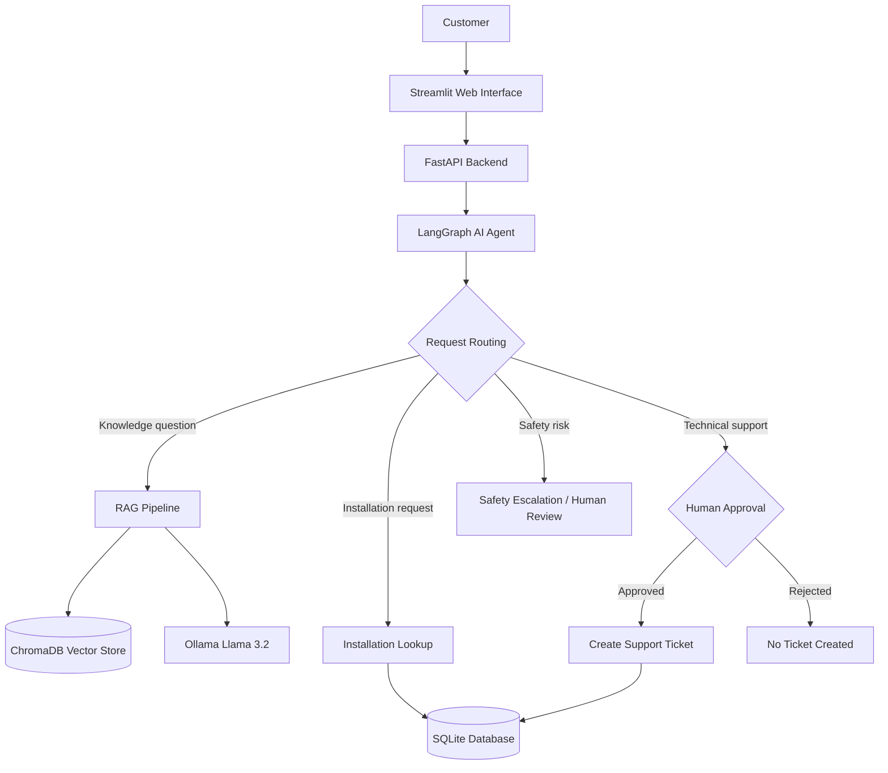

# EnergyOps AI — System Architecture

EnergyOps AI is an agentic AI customer-support prototype for solar energy services. It combines LangGraph, RAG, Ollama, FastAPI, Streamlit, and SQLite.

## Architecture Diagram

## Main Components

- **Streamlit:** Customer-facing web interface.
- **FastAPI:** Receives requests and returns agent results.
- **LangGraph:** Orchestrates classification, routing, and approval workflows.
- **Ollama:** Runs the local LLM and embedding model.
- **ChromaDB:** Stores document embeddings for retrieval.
- **SQLite:** Stores fictional installation records and support tickets.
- **Human Approval:** Requires user confirmation before ticket creation.
- **Safety Escalation:** Routes recognized dangerous situations to human review.

## Example Workflows

### Knowledge Retrieval
Customer asks a question → RAG retrieves documents → Ollama generates an answer with source references.

### Installation Lookup
Customer requests installation status → Agent queries SQLite → Customer receives installation information.

### Support Ticket Creation
Customer reports a technical problem → Agent prepares a ticket → Human approves → Ticket is saved in SQLite.

### Safety Escalation
Customer reports a dangerous issue → Agent recognizes the risk → Request is escalated for human review.

## Limitations

This is a portfolio demonstration using fictional customer data. Safety classification and access controls are not production-grade.
